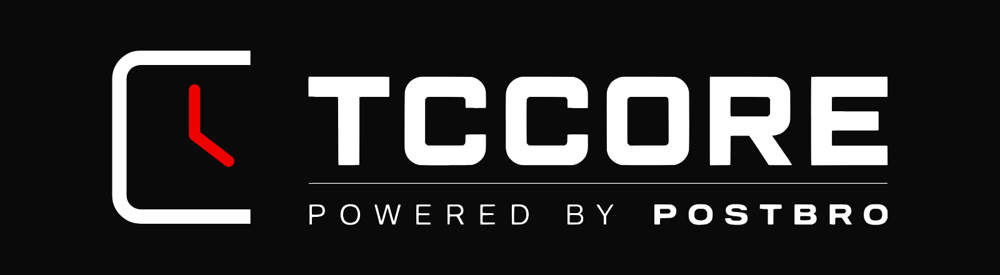
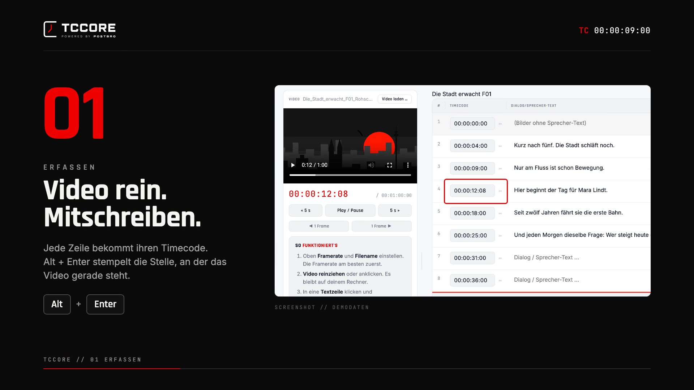
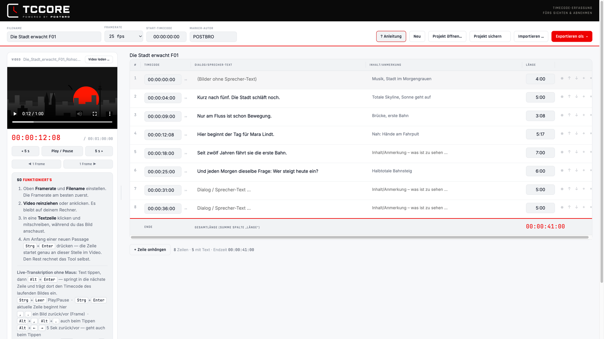

<b>Timecode-Erfassung fürs Sichten und Abnehmen.</b> Video ansehen, mitschreiben, Timecodes setzen. Kostenlos, offline, für Mac und Windows.

---

## Download

Aktuelle Version: **V01-10**

| System | Datei |
|---|---|
| Mac mit Apple-Chip (M1 und neuer) | [TCCORE_V01-10_mac-arm64.dmg](https://github.com/PostBro/tccore/releases/latest/download/TCCORE_V01-10_mac-arm64.dmg) |
| Mac mit Intel-Prozessor | [TCCORE_V01-10_mac-x64.dmg](https://github.com/PostBro/tccore/releases/latest/download/TCCORE_V01-10_mac-x64.dmg) |
| Windows 10 und 11, installieren | [TCCORE_Setup_V01-10_Windows.exe](https://github.com/PostBro/tccore/releases/latest/download/TCCORE_Setup_V01-10_Windows.exe) |
| Windows 10 und 11, ohne Installation | [TCCORE_Portable_V01-10_Windows.exe](https://github.com/PostBro/tccore/releases/latest/download/TCCORE_Portable_V01-10_Windows.exe) |

Alle Versionen unter [Releases](https://github.com/PostBro/tccore/releases).

## So funktioniert's

 Erklärvideo, 30 Sekunden. Klick aufs Bild.

1. **Erfassen.** Video reinziehen, mitschreiben. `Alt` + `Enter` setzt den Timecode der Stelle, an der das Video gerade steht.
2. **Importieren.** Offtext aus Word, Untertitel, EDL, Marker oder Tabellen einlesen. TCCORE findet die Timecodes selbst, auch MM:SS und Zeilen wie INTRO oder Ende.
3. **Exportieren.** Word und PDF für die Abnahme, Untertitel (SRT), Tabelle (CSV), Marker für Avid Media Composer, DaVinci Resolve und Premiere Pro.
4. **Zurückschreiben.** Neue Timecodes und geänderter Text gehen zurück ins Original-Word. Die Formatierung bleibt.

## Installieren

**Mac:** dmg öffnen, TCCORE in den Ordner Programme ziehen. Beim ersten Start meldet macOS einen nicht verifizierten Entwickler: Rechtsklick auf TCCORE, „Öffnen“, noch einmal „Öffnen“. Danach startet die App normal.

**Windows:** Setup ausführen oder die Portable-Datei direkt starten. Zeigt Windows „Der Computer wurde durch Windows geschützt“: „Weitere Informationen“, dann „Trotzdem ausführen“.

Die Apps sind noch nicht mit einem Entwicklerzertifikat signiert, daher diese einmaligen Rückfragen.

## Daten

TCCORE arbeitet komplett offline. Kein Konto, kein Upload. Videos, Projekte und Word-Dateien bleiben auf deinem Rechner.

## Lizenz

Freeware: kostenlos privat und beruflich nutzen, unverändert weitergeben erlaubt. Details und die Lizenzen der enthaltenen Schriften in [LIZENZEN.txt](LIZENZEN.txt).

## Feedback

Fragen, Fehler, Wünsche: [info@postbro.tv](mailto:info@postbro.tv)

---

**English:** TCCORE is a free, offline timecode logging tool for reviewing and approving video: watch, take notes, set timecodes, import and write back Word voice-over scripts, export to Word, PDF, SRT, CSV and markers for Avid, Resolve and Premiere. Interface in German. Downloads above.
